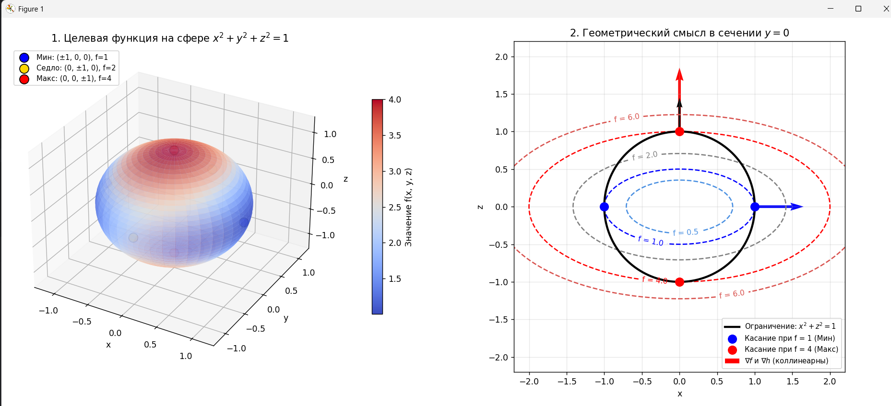

# Дополнительное задание. Геометрический смысл метода множителей Лагранжа

**Вариант 8.** Исследование условных экстремумов функции

$f(x,y,z)=x^2+2y^2+4z^2$

при ограничении

$x^2+y^2+z^2=1.$

## 1. Постановка задачи и допустимое множество

Требуется найти наибольшее и наименьшее значения целевой функции не во всём пространстве \(\mathbb R^3\), а только среди точек, удовлетворяющих условию

$g(x,y,z)=x^2+y^2+z^2-1=0.$

Допустимое множество — сфера радиуса 1 с центром в начале координат. На рисунке слева показана эта сфера. Цвет поверхности соответствует значению \(f(x,y,z)\): синие области имеют меньшие значения функции, а красные — большие.

Так как сфера замкнута и ограничена, она компактна. Функция \(f\) непрерывна, поэтому по теореме Вейерштрасса на сфере обязательно достигаются глобальные минимум и максимум.

## 2. Идея метода множителей Лагранжа

В точке условного экстремума нельзя произвольно двигаться во всех направлениях: движение должно оставаться на поверхности ограничения. Поэтому рассматриваются направления, касательные к допустимому множеству.

В регулярной точке условного экстремума градиент целевой функции перпендикулярен касательной плоскости к поверхности ограничения. Градиент ограничения также перпендикулярен этой касательной плоскости. Следовательно, два градиента параллельны, то есть существует число \(\lambda\), для которого

$\nabla f=\lambda\nabla g.$

Это и есть геометрический смысл множителя Лагранжа: он задаёт коэффициент пропорциональности между нормалями к поверхности ограничения и поверхности уровня целевой функции.

В данной задаче

$
\nabla f=(2x,4y,8z),\qquad
\nabla g=(2x,2y,2z).
$

Составим функцию Лагранжа:

$
\mathcal L(x,y,z,\lambda)
=x^2+2y^2+4z^2
+\lambda(x^2+y^2+z^2-1).
$

Условия стационарности имеют вид

$
\begin{cases}
2x(1+\lambda)=0,\\
2y(2+\lambda)=0,\\
2z(4+\lambda)=0,\\
x^2+y^2+z^2=1.
\end{cases}
$

Из системы получаются шесть точек-кандидатов:

- (1,0,0) и (-1,0,0), при lambda=-1;
- (0,1,0) и (0,-1,0), при lambda=-2;
- (0,0,1) и (0,0,-1), при lambda=-4.

## 3. Как читать рисунок

### Левая часть — целевая функция на сфере

Сфера является допустимым множеством. Цвет показывает значение функции на каждой её точке.

- **Синие точки** $(\pm1,0,0)$: значение (f=1). Это точки глобального минимума.
- **Жёлтые точки** $(0,\pm1,0)$: значение (f=2). Это стационарные точки, но не экстремумы.
- **Красные точки** $(0,0,\pm1)$: значение (f=4). Это точки глобального максимума.

Цветовая шкала помогает увидеть, как значение функции изменяется при перемещении по сфере: от минимальных значений в направлении оси \(x\) к максимальным в направлении оси \(z\).

### Правая часть — сечение плоскостью (y=0)

Для наглядности рассмотрим сечение сферы плоскостью (y=0). Ограничение в этой плоскости принимает вид

$
x^2+z^2=1,
$

то есть окружность.

Целевая функция в том же сечении равна

$
f(x,0,z)=x^2+4z^2.
$

Пунктирные эллипсы — линии уровня целевой функции. На окружности ограничения условный экстремум возникает в точке, где линия уровня касается окружности, не пересекая её локально. В точке касания нормали к линии уровня и окружности параллельны. Это изображает условие

$
\nabla f=\lambda\nabla g.
$

В точках (1,0) и (-1,0) сечения достигается минимум (f=1). В точках (0,1) и (0,-1) достигается максимум (f=4). Стрелки в точках касания иллюстрируют направление градиентов: они коллинеарны, поскольку оба перпендикулярны общей касательной.

Точки $(0,\pm1,0)$ на полном графике соответствуют седловым точкам ограничения функции на сферу. В них значение (f=2): при перемещении по сфере в одних направлениях функция увеличивается, а в других уменьшается. Поэтому эти точки не являются ни условными минимумами, ни условными максимумами.

## 4. Результат и связь с решением варианта

Сравним значения функции во всех найденных точках-кандидатах:

| Точки        | Значение \(f\) | Результат |
|--------------|---------------:|---|
| $(\pm1,0,0)$ |              1 | Глобальный минимум |
| $(0,\pm1,0)$ |              2 | Не являются экстремумами |
| $(0,0,\pm1)$ |              4 | Глобальный максимум |

Итак,

$
\boxed{f_{\min}=1\quad\text{в точках }(\pm1,0,0)}
$

$
\boxed{f_{\max}=4\quad\text{в точках }(0,0,\pm1)}
$

Глобальность результата подтверждается компактностью сферы и непрерывностью целевой функции. Кроме того, непосредственно на сфере можно записать

$
f=x^2+2y^2+4z^2
=1+y^2+3z^2\geq1,
$

а также

$f=4-3x^2-2y^2\leq4.$

Равенства достигаются соответственно в точках $(\pm1,0,0)$ и $(0,0,\pm1)$.

## 5. Краткое объяснение

Метод множителей Лагранжа позволяет найти условные стационарные точки, когда экстремум ищется при ограничении. Геометрически в такой точке градиент целевой функции и градиент ограничения параллельны: они являются нормалями к касательной плоскости или касательной линии в двумерном сечении.

На рисунке сфера показывает допустимое множество, цвет поверхности — значения целевой функции, а отмеченные точки — найденные кандидаты. Линии уровня в сечении демонстрируют касание в точках минимума и максимума. После нахождения всех кандидатов их значения сравниваются, что позволяет определить глобальные экстремумы.
