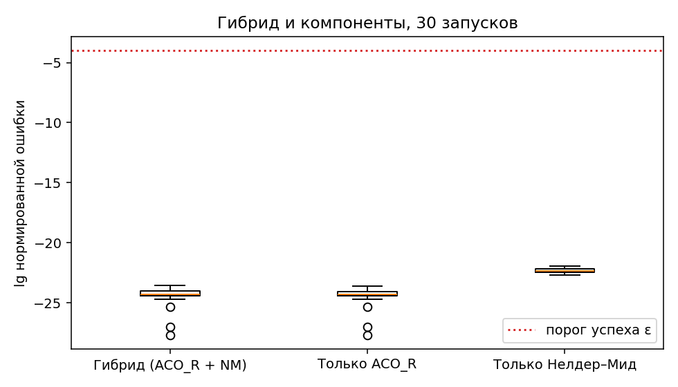
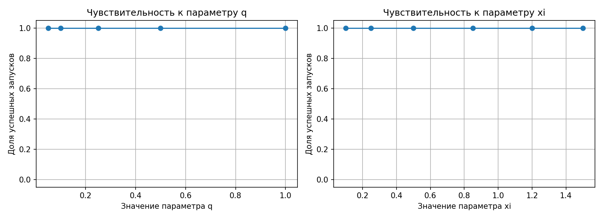

# Самостоятельная работа

**Задание 1:** повторить ручные примеры 1 всех разделов и сверить ответы с методическими указаниями.


---

## 1. Генетический алгоритм (ГА)

**Задача:** минимизировать f(x)=(x-11)^2, x ∈ {0, ..., 15}, код - 4 бита.

### 1.1. Декодирование и функция цели

| Особь | Код | x | f(x)=(x-11)^2 | φ = 1 / (1 + f) |
|---:|:---:|---:|---:|---:|
| 1 | 0101 | 5 | 36 | 0.0270 |
| 2 | 1100 | 12 | 1 | 0.5000 |
| 3 | 0011 | 3 | 64 | 0.0154 |
| 4 | 1001 | 9 | 4 | 0.2000 |

Сумма приспособленностей:0.0270 + 0.5000 + 0.0154 + 0.2000 ≈ 0.7424.

Вероятности рулетки (по исходным округлённым данным):

- особь 1: 0.036;
- особь 2: 0.673;
- особь 3: 0.021;
- особь 4: 0.269.

Ранговые вероятности: (0.2, 0.4, 0.1, 0.3) соответственно.

### 1.2. Турнир и генетические операторы

При турнире размера (s=2):

- в паре (1, 3): сравниваем 36 и 64, побеждает особь 1 (0101);
- в паре (2, 4): сравниваем 1 и 4, побеждает особь 2 (1100).

Одноточечное скрещивание 1100 и 1001 после второго бита:

`11|00` и `10|01` → потомки `1101` (x=13, f=4) и `1000` (x=8, f=9).

Равномерное скрещивание с маской 1010 (1 — ген первого родителя) даёт `1001` (x=9, f=4).

Мутация третьего бита: `1001` → `1011`; код `1011` соответствует (x=11), поэтому (f(11)=0). Найден оптимум.

**Вещественное кодирование:** (a=(1,2), (b=(3,1)).

- Арифметическое скрещивание при (lambda=0.25):
  (c=0.25a+0.75b=(2.5,1.25)).
- BLX-α, α=0.3, x1 выбирается равномерно из
  x_1∈[1-0.3·2, 3+0.3·2]=[0.4,3.6];
  x_2∈[0.7,2.3].

**Проверка:** вычисления и найденный оптимум совпадают с примером на стр. 6 методических указаний.

### Ответы на вопросы

**1. Почему при минимизации нельзя напрямую подставить f в рулетку?**

При минимизации чем меньше значение функции f, тем лучше решение. Однако в рулеточной селекции вероятность выбора особи должна быть тем выше, чем лучше её приспособленность.

Если напрямую использовать f, то особи с большими значениями функции будут иметь большую вероятность выбора, что противоречит задаче минимизации. Кроме того, значения функции могут быть отрицательными, а вероятности не могут быть отрицательными.

Поэтому значение целевой функции необходимо преобразовать в приспособленность, например:

φ = 1 / (1 + f − f_min)


где (f_{min}) — минимальное значение функции в текущей популяции.

После преобразования лучшие особи получают большую вероятность отбора.

**2. Как размер турнира влияет на давление отбора?**

В турнирной селекции случайным образом выбираются s особей, после чего родителем становится лучшая из них.

Чем больше размер турнира s, тем выше вероятность выбрать сильную особь и тем сильнее давление отбора. При большом турнире популяция быстрее сходится к хорошим решениям, но может раньше потерять разнообразие.

При маленьком размере турнира отбор мягче, сохраняется больше разнообразия, однако сходимость может быть медленнее.

**3. Почему обычное одноточечное скрещивание непригодно для перестановок?**

При перестановочном кодировании каждый элемент должен встречаться ровно один раз. Обычное одноточечное скрещивание может нарушить это условие: в потомке могут появиться повторяющиеся элементы и отсутствовать некоторые элементы исходной перестановки.

Поэтому для перестановок применяют специальные операторы скрещивания, например PMX, OX и CX, которые сохраняют корректность перестановки.

**4. Чем ламарковская схема гибрида отличается от болдуиновской?**

В ламарковской схеме локально улучшенная особь возвращается в популяцию непосредственно. Таким образом, результат локального поиска изменяет генотип особи и может передаваться её потомкам.

В болдуиновской схеме улучшенная особь не заменяет исходный генотип. В популяцию возвращается только улучшенное значение приспособленности, а сама особь остаётся прежней.

Главное отличие: **ламарковская схема наследует найденное изменение решения, а болдуиновская — только эффект улучшения на приспособленность.**

---

## 2. Имитация отжига (SA)

Вероятность принять ухудшение Delta f>0:
P = exp(−Δf / T) 

|   (Delta f) | T=10 | T=1 | T=0.1 |
|------------:|---:|---:|---:|
|           1 | e^{-0.1}=0.9048≈0.905 | e^{-1}=0.3679≈0.368 | e^{-10}=4.54·10^{-5} |
|           5 | e^{-0.5}=0.6065≈0.607 | e^{-5}=0.006738≈0.0067 | e^{-50}=1.93·10^{-22} |

Геометрическое охлаждение: T_k=T_0q^k, T_0=10, q=0.95.

- T₁₀ = 10 · 0.95¹⁰ ≈ 5.99;
- T₅₀ = 10 · 0.95⁵⁰ ≈ 0.769 ≈ 0.77.


**Проверка:** значения совпадают с таблицей на стр. 9.


### Ответы на вопросы к разделу 2. Имитация отжига (Simulated Annealing)

**1. Что произойдёт при T_0 → 0? При T_0 → ∈fty?**

При T_0 → 0 вероятность принять ухудшающее решение стремится к нулю. Метод почти всегда принимает только улучшения и становится похож на обычный локальный спуск. Из-за этого он может застрять в локальном минимуме.

При T_0 → ∈fty вероятность принять ухудшение стремится к единице. Метод почти случайно перемещается по области поиска, практически не учитывая качество решений.

Вероятность принятия ухудшения определяется критерием Метрополиса:


P = e^{-Δ f/T},   Δ f>0


**2. Почему шаг соседа полезно уменьшать вместе с температурой?**

При высокой температуре большой шаг позволяет исследовать удалённые области и выходить из локальных минимумов. По мере охлаждения уменьшают шаг, чтобы выполнять более точный поиск около найденного решения.

Таким образом, сначала метод активно исследует пространство решений, а затем постепенно переходит к уточнению результата.

**3. Как применить критерий Метрополиса внутри другого метода (ГА, PSO, DE)?**

Критерий Метрополиса можно использовать как дополнительное правило принятия решения:

1. Получить новое решение-кандидат.
2. Вычислить изменение целевой функции: Δf = f_new − f_old 
3. Если Δf ≤ 0, принять новое решение.
4. Если Δf > 0, принять его с вероятностью e^(-Δf / T).
5. Постепенно снижать температуру T.

Примеры применения:

- **ГА:** использовать критерий при решении, заменять ли родительскую особь ухудшившимся потомком.
- **PSO:** применять его при выборе лидера роя или принятии нового решения в качестве текущего.
- **DE:** использовать при выборе между целевой особью и пробным вектором.

Это позволяет методам иногда принимать ухудшения и тем самым повышать возможность выхода из локальных минимумов.

---

## 3. Поиск с запретами (Tabu Search)

Дано:

| x   | 0 | 1 | 2 | 3 | 4 | 5 | 6 | 7 | 8 | 9 | 10 |
|-----|---:|---:|---:|---:|---:|---:|---:|---:|---:|---:|---:|
| f(x) | 5 | 3 | 4 | 6 | 2 | 1 | 3 | 7 | 4 | 0 | 6 |

Обычный локальный спуск из x=0: сравниваем соседей. f(1)=3<f(0)=5, поэтому переходим в x=1. Там f(0)=5 и f(2)=4, оба хуже f(1)=3, значит спуск останавливается в локальном минимуме x=1, f=3.

При запретном сроке 3 возврат к недавно посещённой точке запрещён. Алгоритм может пройти:
0 → 1 → 2 → 3 → 4 → 5 → 6 → 7 → 8 → 9 → 10
На всём множестве минимум f(9)=0, следовательно глобальное решение — x=9.

**Проверка:** маршрут и минимум соответствуют стр. 10.

### Ответы на вопросы к разделу 3. Поиск с запретами (Tabu Search)

**1. Что будет при слишком коротком и слишком длинном сроке запрета?**

При слишком коротком сроке запрета метод быстро забывает ранее посещённые решения и может часто возвращаться к ним. Это снижает эффективность поиска и повышает вероятность зацикливания.

При слишком длинном сроке запрета многие решения и ходы остаются недоступными на протяжении большого числа итераций. Из-за этого метод может пропускать перспективные области поиска и двигаться слишком далеко от хороших решений.

**2. Как определить «запрещённость» точки в непрерывной задаче?**

В непрерывной задаче запрещённость можно определять с помощью окрестности радиуса r вокруг ранее посещённой точки.

Если расстояние между текущим кандидатом y и запрещённой точкой x_tabu меньше радиуса r, то кандидат считается запрещённым:

‖y − x_tabu‖ < r

Таким образом, метод не возвращается в уже исследованные области пространства решений. При этом запрет можно снять по критерию стремления (aspiration), если найденное решение лучше рекордного.

---

## 4. Муравьиный алгоритм (ACO)

Муравей находится в городе A; alpha=1, beta=2. Вес перехода:
w_ij = τ_ij^α · η_ij^β,   η_ij = 1 / d_ij


| Город | d | τ | τη^2 | Вероятность |
|---|---:|---:|---:|---:|
| B | 2 | 1 | 1·(1/2)^2=0.250 | 0.250/0.415≈0.602 |
| C | 4 | 2 | 2·(1/4)^2=0.125 | 0.125/0.415≈0.301 |
| D | 5 | 1 | 1·(1/5)^2=0.040 | 0.040/0.415≈0.096 |

Сумма весов 0.250+0.125+0.040=0.415.

Обновление феромона на ребре AB:

τ_{AB}^{new}=(1-ρ)τ_{AB}+Q/L
=0.5·1+10/12=1.333≈1.33.


**Проверка:** вероятности и обновление совпадают со стр. 12.


### Ответы на вопросы к разделу 4. Муравьиные алгоритмы (ACO)

**1. Какую роль играют параметры α и β? Что будет при α=0 или β=0?**

Параметры α и β определяют влияние феромона и эвристической информации на выбор следующего перехода муравьём.

- α — степень влияния феромона τ_{ij}. Чем больше α, тем сильнее муравьи предпочитают рёбра с большим количеством феромона.
- β — степень влияния эвристической информации η_{ij}, например обратной длины ребра η_{ij}=1/d_{ij}. Чем больше β, тем сильнее предпочтение отдаётся коротким рёбрам.

Вероятность перехода задаётся формулой:


p_{ij}=
frac{τ_{ij}^{α}η_{ij}^{β}}
{sum_{l∈{допустимые}}τ_{il}^{α}η_{il}^{β}}


Если α=0, влияние феромона исчезает, и выбор определяется только эвристической информацией.

Если β=0, влияние эвристики исчезает, и выбор определяется только феромоном.

**2. Зачем нужно испарение феромона? Что его заменяет в ACO_R?**

Испарение феромона необходимо для того, чтобы алгоритм постепенно забывал менее удачные пути. Оно предотвращает чрезмерное накопление феромона на одном маршруте и помогает сохранять разнообразие поиска.

Обновление феромона при испарении выполняется по формуле:


τ_{ij}arrow(1-ρ)τ_{ij}


где ρ — коэффициент испарения.

В алгоритме **ACO_R** для непрерывных задач феромон заменяется архивом из k лучших решений, упорядоченных по значению целевой функции. Новые решения генерируются на основе этого архива, а его обновление позволяет постепенно отказываться от менее перспективных решений.

---

## 5. Искусственная пчелиная колония (ABC)

Дано: x_i=(1,2), x_k=(3,-1), выбрана первая координата d=1, φ=-0.5.

Формула рабочей пчелы:

v_{id}=x_{id}+φ(x_{id}-x_{kd}).


Подстановка:

v=(1+(-0.5)(1-3), 2)=(1+1, 2)=(2,2).


Далее качество источника и вероятность выбора наблюдателями:

| Источник | f | fit | p=fit/sum fit |
|---:|---:|---:|---:|
| 1 | 0.5 | 1/(1+0.5)=0.667 | 0.667/3.091≈0.216 |
| 2 | 2 | 1/3=0.333 | 0.333/3.091≈0.108 |
| 3 | 10 | 1/11=0.091 | 0.091/3.091≈0.029 |
| 4 | −1 | 1+|-1|=2.000 | 2/3.091≈0.647 |

Сумма fit≈3.091.

**Проверка:** точка v=(2,2) и вероятности соответствуют стр. 14.

### Ответы на вопросы к разделу 5. Пчелиная колония (ABC)

**1. Почему ABC меняет только одну координату за шаг? Когда это хорошо, а когда плохо?**

В алгоритме ABC за один шаг изменяется только одна случайно выбранная координата решения. Это позволяет локально исследовать окрестность источника и постепенно уточнять его положение.

Такой подход хорошо работает для сепарабельных функций, в которых переменные слабо связаны между собой: изменение одной координаты может улучшить решение независимо от остальных.

Однако для функций с сильно связанными переменными это может быть недостатком. Например, в овражных функциях оптимальное направление часто требует одновременного изменения нескольких координат. Изменение только одной координаты может замедлить поиск или привести к застреванию.

**2. Чем роль разведчиков похожа на мутацию в ГА?**

Разведчики в ABC случайно ищут новые источники пищи в пространстве решений. Если источник долго не улучшается и его счётчик неудач превышает `limit`, он заменяется новым случайным источником.

Это похоже на мутацию в генетическом алгоритме: оба механизма вводят случайные изменения и поддерживают разнообразие популяции, помогая выходить из локальных минимумов.

Главное отличие состоит в том, что мутация обычно изменяет отдельные гены существующей особи, а разведчик в ABC может полностью заменить устаревший источник новым случайным решением.

---

## 6. Пчелиный алгоритм Bees

Параметры: n=20, m=5, e=2, nep=10, nsp=4.

В одной итерации:
- элитные участки: e· nep=2·10=20 оценок;
- остальные выбранные участки: (m-e)· nsp=(5-2)·4=12 оценок;
- разведчики: n-m=20-5=15 оценок.

Итого:

20+12+15=47

вычислений функции за итерацию.

Число полных итераций при бюджете 10 000:

\lfloor10000/47\rfloor=212,

так как 47·212=9964, а 47·213=10011>10000.

**Проверка:** 47 вычислений и 212 итераций — результат из стр. 14–15.

---

## 7. Рой частиц (PSO)

Дано:
x=(2,1), v=(0.5,-0.5), p=(1.5,1), g=(0,0),
w=0.7, c_1=c_2=1.5,
r_1=(0.4,0.8), r_2=(0.6,0.2).

Формула:

v'=wv+c_1r_1\odot(p-x)+c_2r_2\odot(g-x).


Составляющие:
- инерция: 0.7(0.5,-0.5)=(0.35,-0.35);
- личная: 1.5(0.4,0.8)\odot(-0.5,0)=(-0.3,0);
- социальная: 1.5(0.6,0.2)\odot(-2,-1)=(-1.8,-0.3).

Суммируем:

v'=(0.35,-0.35)+(-0.3,0)+(-1.8,-0.3)=(-1.75,-0.65).


Новое положение:

x'=x+v'=(2,1)+(-1.75,-0.65)=(0.25,0.35).


**Проверка:** скорость и положение совпадают со стр. 16.

### Ответы на вопросы к разделу 7. Рой частиц (PSO)

**1. Почему без ограничения скорости рой может «взорваться»?**

Скорость частицы складывается из инерционной составляющей и притяжения к личному и глобальному лучшим положениям. Без ограничения скорости эти составляющие могут привести к слишком большим шагам.

Частицы начинают перелетать через область оптимума, удаляться от него и выходить за границы допустимой области. В результате поиск становится нестабильным и может расходиться — это называют «взрывом» роя.

Ограничение скорости v_{max} помогает удерживать движение частиц в разумных пределах. В методичке рекомендуется выбирать его примерно равным 10–20 % ширины области поиска.

**2. Что будет при c_2=0? При c_1=0?**

- **При c_2=0** исчезает социальная составляющая — частицы перестают притягиваться к глобальному лучшему решению g. Они ориентируются на собственный опыт и инерцию, поэтому рой теряет согласованность и может медленно сходиться.
- **При c_1=0** исчезает когнитивная составляющая — частицы не учитывают свои лучшие найденные положения p_i. Движение определяется инерцией и притяжением к глобальному лидеру g. Рой может быстро стянуться к лидеру, но потерять разнообразие и застрять в локальном минимуме.

---

## 8. Дифференциальная эволюция (DE)

Дано:
x_{r1}=(1,1), x_{r2}=(3,0), x_{r3}=(2,2),
x_i=(0,0.5), F=0.5, CR=0.9.

### Мутация

v=x_{r1}+F(x_{r2}-x_{r3}).

Разность x_{r2}-x_{r3}=(1,-2), поэтому

v=(1,1)+0.5(1,-2)=(1.5,0).


### Бинарное скрещивание

1. r=(0.3,0.95), j_{rand}=2.  
   Первая координата берётся из v, так как 0.3<CR; вторая обязательно из v, так как j=j_{rand}.  
   u=(1.5,0).

2. r=(0.95,0.95), j_{rand}=1.  
   Первая координата берётся из v по условию j=j_{rand}; вторая — из x_i, так как 0.95>CR.  
   u=(1.5,0.5).

**Проверка:** мутант и два пробных вектора совпадают со стр. 17.

### Ответы на вопросы к разделу 8. Дифференциальная эволюция (DE)

**1. Почему размер шага DE уменьшается без явного управления?**

В DE размер шага определяется разностью между случайными особями популяции:


v = x_{r_1} + F(x_{r_2} - x_{r_3})


В начале поиска особи сильно различаются, поэтому разность между ними большая и шаги получаются крупными. По мере эволюции популяция сближается, разброс уменьшается, а вместе с ним автоматически уменьшается и размер шага.

Таким образом, DE самостоятельно переходит от широкого исследования пространства к более точному поиску, без отдельного управления размером шага.

**2. Зачем нужен индекс j_{rand}?**

Индекс j_{rand} гарантирует, что хотя бы одна координата пробного вектора будет взята из мутантного вектора v, а не из исходной особи x_i.

Без этого индекса при случайном скрещивании может оказаться, что ни одна координата не перейдёт от мутантного вектора. Тогда пробный вектор совпадёт с исходным, и мутация фактически не повлияет на решение.

---

## 9. Поиск кукушки (Cuckoo Search)

Для параметра β=1.5 в методических указаниях приведено:

\sigma_u=0.6966.


По экспериментальной выборке из 100 000 шагов:

| Распределение | Доля |L|>3 | 99-й перцентиль |L| |
|---|---:|---:|
| Леви, β=1.5 | 7.5% | 11.6 |
| Гауссово N(0,1) | 0.26% | 2.6 |

Сравнение долей:

7.5/0.26≈28.85,

то есть длинные шаги у распределения Леви встречаются примерно в 29 раз чаще (в указаниях — около 30 раз).

**Проверка:** численные результаты приведены в примере на стр. 18.

---

## 10. Островная модель

Три острова: GA, PSO и DE; по 30 особей; общий бюджет 10 000 вычислений; миграция каждые 10 поколений, по кольцу, по 2 мигранта.

Стоимость одного совместного поколения:

30+30+30=90

вычислений.

Число поколений:

\lfloor10000/90\rfloor=111

(111 поколений стоят 9990 вычислений; остаётся 10).

При миграции каждые 10 поколений число миграционных событий за 111 поколений:

\lfloor111/10\rfloor=11.


**Проверка:** 111 поколений и 11 миграций соответствуют примеру на стр. 19.

---

## 11. Метод Нелдера–Мида

Функция f=x_1^2+2x_2^2. Вершины симплекса:
(1,1),(2,1),(1,2); значения: 3,6,9.

Худшая вершина — (1,2), поскольку 9 — наибольшее значение. Центр двух лучших:

c=((1+2)/2, (1+1)/2)=(1.5,1).


Отражение худшей вершины:

x_r=c+(c-(1,2))=(1.5,1)+(0.5,-1)=(2,0).

Значение:

f(2,0)=2^2+2·0^2=4.


4 лучше второго значения 6, но хуже лучшего 3, поэтому принимается отражение.

Новый симплекс: (1,1),(2,0),(2,1).

Дополнительно:
- растяжение x_e=c+2(c-x_3)=(2.5,-1), f=2.5^2+2(-1)^2=8.25;
- внешнее сжатие x_c=c+0.5(x_r-c)=(1.75,0.5), f=1.75^2+2(0.5)^2=3.5625.

**Проверка:** результаты совпадают со стр. 21.

### Ответы на вопросы к разделу 11. Метод Нелдера–Мида (симплексный поиск)

**1. Почему стартовый симплекс должен быть невырожденным?**

Стартовый симплекс должен иметь ненулевой объём: в n-мерном пространстве его n+1 вершин должны быть аффинно независимы. Это позволяет симплексу исследовать все направления пространства поиска.

Если симплекс вырожден, он может лежать в подпространстве меньшей размерности. Тогда алгоритм будет ограничен этим подпространством и может не найти оптимум, расположенный вне него.

**2. Что произойдёт, если стартовый шаг больше расстояния между локальными минимумами?**

Если стартовый шаг слишком велик, симплекс может перескакивать через области локальных минимумов, не исследуя их достаточно подробно. Это повышает вероятность пропустить перспективные области и затрудняет локальное уточнение решения.

Поэтому в гибридных методах начальный шаг симплекса выбирают соразмерно расстоянию между соседними локальными минимумами или меньше него.

---

## 12. Метод ломаных (Пиявского)


g(x)=sin x+sin(10x/3),  [a,b]=[2.7,7.5],  L=6.

Начальные значения: g(2.7)=0.8395, g(7.5)=0.8056.

Первая пробная точка:

\hat x=frac{a+b}{2}-frac{g(b)-g(a)}{2L}
=5.1-frac{0.8056-0.8395}{12}
=5.1028.


Нижняя оценка на отрезке:

\hat g= frac{g(a)+g(b)}2-frac{L(b-a)}2


=frac{0.8395+0.8056}{2}-frac{6(7.5-2.7)}2
≈-13.577

| Итерация | \hat x | Нижняя оценка | Рекорд до итерации |
|---:|---:|---:|---:|
| 1 | 5.1028 | −13.577 | 0.8056 |
| 2 | 6.0769 | −7.733 | −1.8887 |
| 3 | 4.1288 | −7.733 | −1.8887 |
| 4 | 3.4763 | −3.818 | −1.8887 |
| 5 | 4.7812 | −3.818 | −1.8887 |
| 6 | 5.3673 | −3.476 | −1.8887 |


### Ответы на вопросы к разделу 12. Метод ломаных (Пиявского)

**1. Что произойдёт, если взять L меньше истинной константы? Больше?**

Если L меньше истинной константы Липшица, построенные конусы могут оказаться выше функции и перестать быть гарантированными нижними оценками. В этом случае метод может ошибочно исключить перспективные участки и не найти глобальный минимум.

Если L больше истинной константы, нижние оценки остаются корректными, но становятся более грубыми. Метод будет исследовать пространство осторожнее, потребуется больше вычислений функции, и сходимость может замедлиться.

**2. Почему метод ломаных не обобщается на двумерный случай напрямую так же просто?**

В одномерном случае нижние оценки строятся с помощью конусов, а их максимум образует ломаную, минимум которой легко найти на отрезках.

В двумерном пространстве вместо ломаной возникает поверхность из конусов. Поиск её глобального минимума и построение точных нижних оценок становятся значительно сложнее. Также увеличивается число областей, которые необходимо исследовать.

Поэтому в многомерных задачах метод обычно применяют вдоль отдельных координат или выбранных направлений, а не напрямую ко всему пространству.

---

## 13. Функция Лагранжа

Задача:

min x_1^2+x_2^2,  x_1+x_2=1.


Функция Лагранжа:

L=x_1^2+x_2^2+λ(x_1+x_2-1).


Условия стационарности:

frac{∂ L}{∂ x_1}=2x_1+λ=0, 
frac{∂ L}{∂ x_2}=2x_2+λ=0,
  x_1+x_2=1.


Из первых двух равенств x_1=x_2. Тогда 2x_1=1, то есть:

x_1=x_2=0.5,  λ=-1.


Целевое значение:

f=0.5^2+0.5^2=0.25+0.25=0.5.


**Проверка:** решение и множитель совпадают со стр. 24.

### Ответы на вопросы к разделу 13. Метод множителей Лагранжа, модифицированная функция Лагранжа и штрафы

**1. Почему при штрафе с большим коэффициентом задача становится трудной для любого метода?**

При большом коэффициенте штрафа даже небольшое нарушение ограничения вызывает резкое увеличение значения целевой функции. Вблизи границы допустимой области функция становится плохо обусловленной: возникают узкие и крутые участки, а различия между значениями функции сильно возрастают.

Из-за этого методы оптимизации могут делать слишком маленькие шаги, медленно сходиться или испытывать трудности с поиском направления улучшения. Поэтому чрезмерно большой штраф затрудняет решение задачи.

**2. Как по знаку множителя Лагранжа понять, активно ли ограничение?**

Для неравенства g_i(x)≤ 0 ограничение является активным, если в оптимальной точке g_i(x^*)=0, то есть решение находится на границе допустимой области.

В методе множителей Лагранжа активность ограничения определяется не только знаком множителя, но и значением самого ограничения:

- Если g_i(x^*)=0 и λ_i>0, ограничение активно и влияет на оптимум.
- Если g_i(x^*)<0 и λ_i=0, ограничение неактивно.
- Для неравенств в условиях Куна–Таккера множитель должен удовлетворять λ_i≥ 0.

Таким образом, положительный множитель обычно указывает на активное ограничение, а нулевой множитель — на неактивное, при условии выполнения условий оптимальности.

---

## 14. Декомпозиция по координатам

Функция Стыблинского–Танга сепарабельна:

f(x_1,x_2)=h(x_1)+h(x_2), 
h(t)=frac12(t^4-16t^2+5t).


По таблице значений h(t) на узлах t=-5,-4,\ldots,5 минимум достигается при t=-3, где h(-3)=-39.

Следовательно, для двух координат:

x^*=(-3,-3),  f(x^*)=-39-39=-78.


Количество вычислений:
- полный перебор сетки 11\times11: 11^2=121;
- покоординатный перебор: 2·11=22.

Экономия:

121-22=99

вычислений, то есть покоординатный подход требует примерно 121/22=5.5 раза меньше вычислений.

**Проверка:** узел, значение функции и число вычислений совпадают со стр. 25.

---

## 15. Численный градиент и BFGS

Функция Розенброка:

f(x_1,x_2)=100(x_2-x_1^2)^2+(1-x_1)^2.


Точка: (-1.2,1). Центральная разность:

frac{∂ f}{∂ x_i}≈
frac{f(x+he_i)-f(x-he_i)}{2h},  h≈10^{-6}.


Аналитические производные:

frac{∂ f}{∂ x_1}
=-400x_1(x_2-x_1^2)-2(1-x_1),


frac{∂ f}{∂ x_2}
=200(x_2-x_1^2).


Подстановка x_1=-1.2, x_2=1:

x_2-x_1^2=1-1.44=-0.44.


frac{∂ f}{∂ x_1}
=-400(-1.2)(-0.44)-2(2.2)
=-211.2-4.4=-215.6.


frac{∂ f}{∂ x_2}=200(-0.44)=-88.0.


Итак, градиент:

∇ f(-1.2,1)=(-215.6,-88.0).


**Проверка:** результат совпадает с примером на стр. 26.

---

## Итог сверки

- Выполнены ручные расчёты по примерам методов из частей A и B.
- Результаты совпадает с примерами из методички

**Задание 2:** для своего варианта запустите оба компонента по отдельности на своей функции (30 запусков) и заполните таблицу из раздела 7 отчёта.

Выполнено:


`python demo.py --func himmelblau --runs 30` (бюджет одинаковый — 10 000 вычислений)

x* = (3.584428, -1.848127)  f = 3.590894841e-25  время = 0.9919 с

| Метод                 | Доля успехов | Медиана lg e | Среднее время, с |
|-----------------------|--------------|---|---|
| Гибрид                | 1.0          | -24.27 | 0.9952 |
| Только ACO_R          | 1.0          | -24.27 | 1.1104 |
| Только Нелдера - Мида | 1.0          | -22.32 | 0.1493 |



Вывод: Все три метода успешно нашли минимум функции Химмельблау во всех 30 запусках. Гибрид показал такую же медиану ошибки, как и ACO_R, но при этом среднее время его работы оказалось немного меньше: 0.9952 с против 1.1104 с. Метод Нелдера — Мида работал быстрее остальных, однако точность его результата была немного ниже.

Таким образом, в данном эксперименте гибрид объединил преимущества двух методов: глобальный поиск ACO_R и локальное уточнение методом Нелдера — Мида. При этом заметного выигрыша по точности относительно ACO_R не получилось. Гибрид может проиграть отдельным методам, если распределение вычислительного бюджета между этапами окажется неудачным или глобальный поиск не найдёт подходящую область для локального уточнения.


**Задание 3:** найдите для метода из своего варианта параметр, к которому он наиболее чувствителен, и постройте зависимость доли успехов от этого параметра.


Для решения данного задания, я создала файл [sensitivity.py](sensitivity.py)

С его помощью исследовалось влияние параметров алгоритма ACO_R на долю успешных запусков гибридного метода ACO_R + Нелдер - Мид.

В эксперименте проверялись два параметра:
- q — параметр, определяющий распределение вероятностей выбора решений из архива. Он влияет на то, насколько часто алгоритм выбирает лучшие решения;
- xi — коэффициент масштаба разброса гауссовых ядер. Он определяет степень разброса новых решений относительно выбранных решений из архива.

Для каждого значения исследуемого параметра выполнялось 30 независимых запусков алгоритма с разными начальными значениями генератора случайных чисел. Остальные параметры оставались неизменными.

По результатам запусков рассчитывалась доля успешных запусков:

$P_{успеха} = frac{N_{успешных запусков}}{N_{всех запусков}}$


Полученные результаты сохранялись в файл sensitivity_results.csv. Также строился график зависимости доли успешных запусков от значения исследуемого параметра.



```
Проверка параметра q
q = 0.05: успехов 30/30, доля = 1.00, медиана lg e = -24.31
q = 0.1: успехов 30/30, доля = 1.00, медиана lg e = -24.28
q = 0.25: успехов 30/30, доля = 1.00, медиана lg e = -24.27
q = 0.5: успехов 30/30, доля = 1.00, медиана lg e = -24.44
q = 1.0: успехов 30/30, доля = 1.00, медиана lg e = -24.15

Проверка параметра xi
xi = 0.1: успехов 30/30, доля = 1.00, медиана lg e = -21.39
xi = 0.25: успехов 30/30, доля = 1.00, медиана lg e = -21.65
xi = 0.5: успехов 30/30, доля = 1.00, медиана lg e = -24.35
xi = 0.85: успехов 30/30, доля = 1.00, медиана lg e = -24.27
xi = 1.2: успехов 30/30, доля = 1.00, медиана lg e = -24.50
xi = 1.5: успехов 30/30, доля = 1.00, медиана lg e = -24.19

Сравнение параметров:
q: изменение доли успехов = 0.00
xi: изменение доли успехов = 0.00

```


В проведённом эксперименте не удалось выявить наиболее чувствительный параметр по критерию доли успешных запусков. При изменении обоих параметров в выбранных диапазонах доля успехов оставалась неизменной и равной 100%.

При этом значения медианы логарифма ошибки показывают, что параметр xi заметнее влияет на точность получаемого решения. Например, при xi = 0.1 медиана составляет −21.39, а при xi = 0.5 — −24.35. Для параметра q изменения медианы ошибки значительно меньше.

Таким образом, в рамках проведённого эксперимента параметр xi сильнее влияет на точность решения, однако по доле успешных запусков чувствительность ни одного из параметров не выявлена.

**Задание 4:** объясните, какие требования к функции (непрерывность, липшицевость, гладкость, сепарабельность) предъявляет каждый компонент вашего гибрида и выполняются ли они для вашей тестовой функции.

ACO_R не требует гладкости, липшицевости и сепарабельности функции. Алгоритм использует значения целевой функции для выбора перспективных решений.

Метод Нелдера — Мида не требует вычисления производных. Для его эффективной работы желательно, чтобы функция была непрерывной и гладкой.

Функция Химмельблау обладает следующими свойствами:
- Непрерывность — выполняется, так как функция является многочленом.
- Липшицевость — выполняется на ограниченной области [-5,5]^2.
- Гладкость — выполняется, так как функция имеет непрерывные производные всех порядков.
- Сепарабельность — не выполняется, так как переменные x_1 и x_2 взаимосвязаны.
Вывод: функция Химмельблау подходит для выбранного гибрида ACO_R + Нелдер — Мид. Несепарабельность функции не препятствует работе этих методов.


