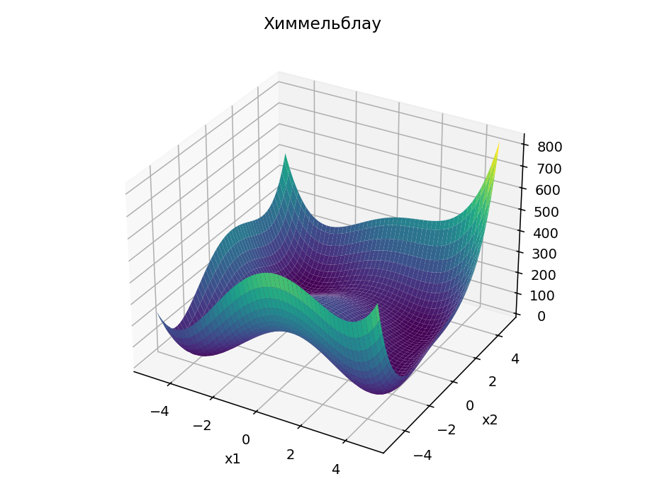
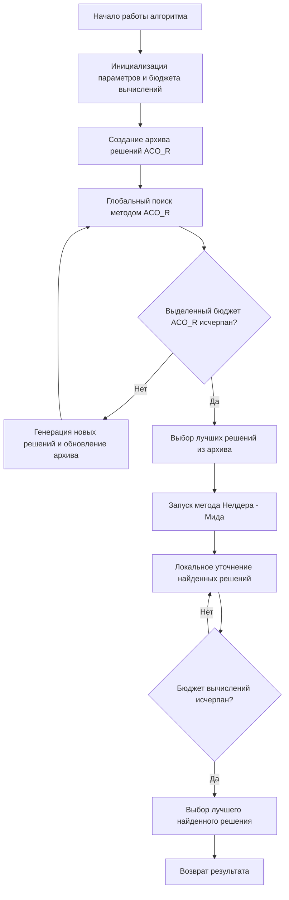
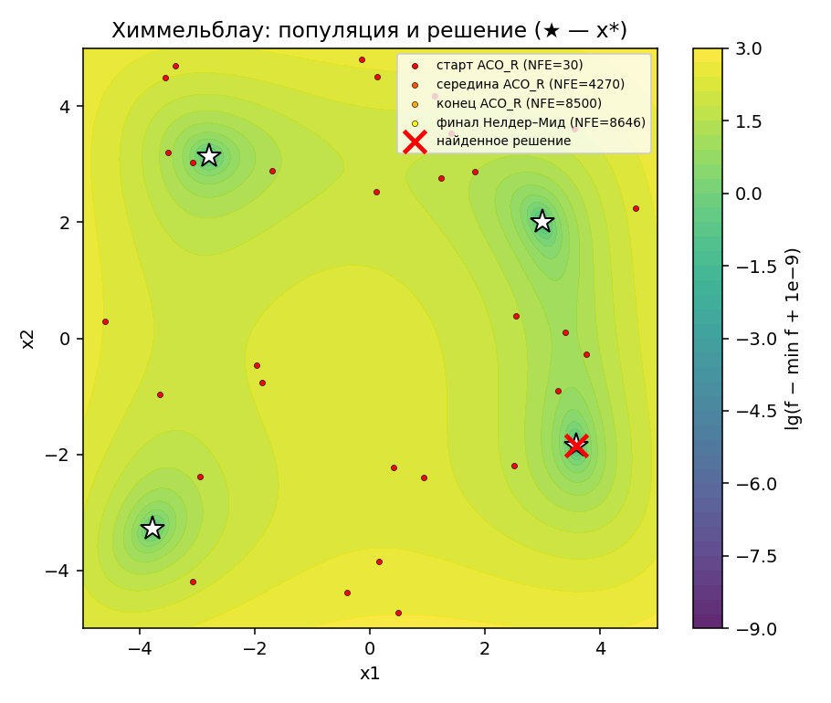
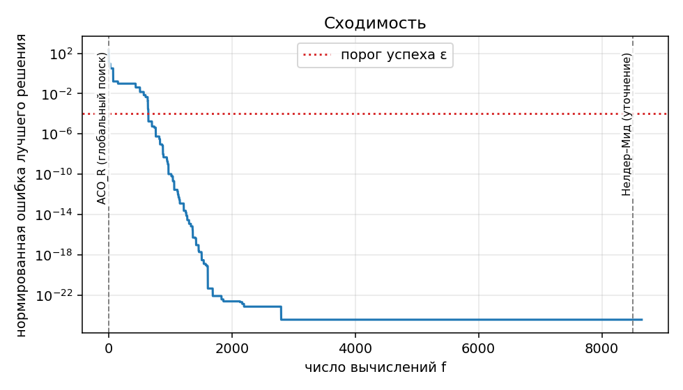
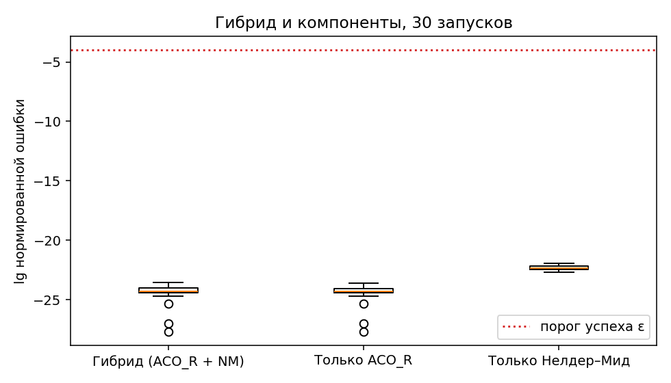
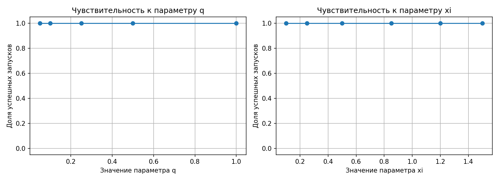
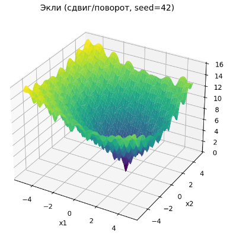
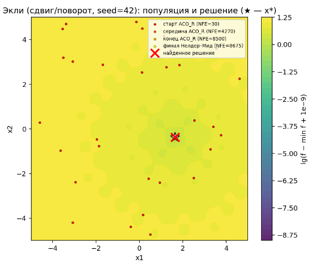
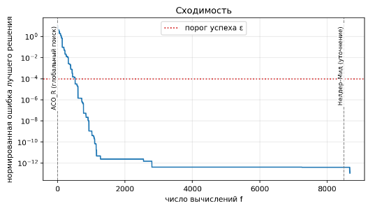
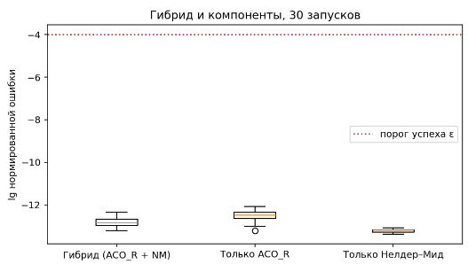

# Битва методов оптимизации: ACO_R (архив решений, гауссовы ядра) + NM


1. ACO_R (Ant Colony Optimization for Continuous Domains) — это адаптация муравьиного алгоритма для решения задач непрерывной оптимизации (где переменные принимают вещественные значения, а не дискретные).
В отличие от классического муравьиного алгоритма, который строит пути на графе, ACO_R использует архив решений и гауссовы ядра (смесь нормальных распределений) для генерации новых точек в пространстве поиска.

2. NM - (Nelder-Mead, метод Нелдера — Мида), также известный как метод деформируемого многогранника или симплекс-метод безусловной оптимизации — это классический алгоритм локальной оптимизации, предложенный Джоном Нелдером и Роджером Мидом в 1965 году.
Его главная особенность в том, что он не требует вычисления производных (градиентов) — алгоритму нужны только значения самой функции в точках.

| |                                                                                       |
|---|---------------------------------------------------------------------------------------|
| Студент | Степанова Екатерина Андреевна                                                         |
| Группа / поток | K3341 / поток   1.2                                                                   |
| Номер в списке потока | 28                                                                                    |
| Преподаватель | Лаврентьев Савелий Михайлович                                                         |
| Вариант | № 8                                                                                   |
| Компоненты гибрида | ACO_R (архив решений, гауссовы ядра) + NM                                               |
| Тестовая функция | функция Химмельблау (himmelblau), `--func himmelblau`                                            |
| Код | [optimizer.py](optimizer.py), запуск — [run.py](run.py), рисунки — [demo.py](demo.py) |

## 1. Тестовая функция

В качестве тестовой функции используется функция Химмельблау, определённая на двумерной области.

$$
f(x_1,x_2)=(x_1^2+x_2-11)^2+(x_1+x_2^2-7)^2
$$

| Область \(D\)    | \(f^*\) | \(x^*\) | Особенности                                                                                                                                                                                                                                                                                                                                        |
|------------------|---------|---|----------------------------------------------------------------------------------------------------------------------------------------------------------------------------------------------------------------------------------------------------------------------------------------------------------------------------------------------------|
| [-5, 5] × [-5, 5]| 0    | (3,2), (-2.805118,3.131313), (-3.779310,-3.283186), (3.584428,-1.848127) | других локальных минимумов, кроме 4х указанных глобальных, у функции нет(с f = 0);  в центре есть 1 локальный максимум и 4 седловые точки); Овраги отсутствуют(воронки минимумов почти симметричны, без узких изогнутых долин); плато отсуствует(рельеф гладкий, с плавным переходом от центрального холма к воронкам), минимумов на границе нет(все экстремумы находятся строго внутри стандартной области ([-5, 5]^2), на краях функция резко возрастает) |



## 2. Идея комбинации

В моей работе используется гибрид двух методов оптимизации, это ACO_R и Нелдера - Мида.
Сначала ACO_R исследует область поиска, а к концу работы архив решений стягивается к одному из четырёх минимумов.
Затем лучшая точка архива передаётся методу Нелдера - Мида, который уточняет решение.
Я выбрала такую комбинацию, потому что функция Химмельблау имеет четыре разных глобальных минимума, и найти их одним локальным методом может быть сложнее.
ACO_R помогает исследовать всю область поиска, а Нелдера - Мид уточняет результат.
При этом метод Нелдера - Мида не требует вычисления производных, что удобно для такой задачи.
(если кратко, то за глобальное исследование отвечает ACO_R, за локальное уточнение отвечает метод NM)

В итоге методы дополняют друг друга: первый отвечает за поиск перспективных областей, а второй - за более точное нахождение минимума. В моей реализации на ACO_R выделяется 85% вычислений, а на Нелдера — Мида — оставшиеся 15%.

- Схема гибридизации: последовательная
- Роль компонента 1 ACO_R: глобальный поиск, формирование архива решений и генерация новых точек с помощью гауссовых распределений
- Роль компонента 2 NM: локальное уточнение найденных решений
- Правило переключения:переход к методу Нелдера - Мида после завершения выделенного бюджета вычислений для ACO_R.
- Распределение бюджета: 85% вычислений выделяется ACO_R, 15% — Нелдеру - Миду.
- Требования к функции, которые предъявляет каждый компонент: ACO_R работает с непрерывными переменными и использует значения целевой функции для выбора перспективных решений. Метод Нелдера — Мида не требует вычисления производных; для его устойчивой работы желательно, чтобы функция была непрерывной и достаточно гладкой. Функция Химмельблау удовлетворяет этим требованиям.

## 3. Схема алгоритма



Алгоритм сначала распределяет бюджет вычислений между двумя этапами. После завершения глобального поиска архив используется для выбора начальных точек локального поиска. В конце возвращается лучшее найденное решение.

### Обоснование параметров метода в коде 

Для гибридного алгоритма ACO_R + Нелдер–Мид используются следующие параметры:


```

DEFAULTS = dict(
    archive_size=30,      # k: размер архива решений ACO_R
    n_ants=10,            # m: число муравьёв, генерируемых на одной итерации
    q=0.25,               # параметр селективности гауссовых весов архива
    xi=0.85,              # скорость испарения (масштаб разброса sigma)
    local_share=0.15,     # доля бюджета NFE на локальное уточнение Нелдером–Мидом
    n_starts=3,           # число стартовых кластеров из архива для Нелдера–Мида
    nm_step=0.03,         # начальный шаг симплекса (доля от ширины области)
)

```

- Размер архива archive_size = 30.

Архив содержит 30 лучших найденных решений. Такой размер позволяет сохранять несколько перспективных областей поиска и использовать их для генерации новых кандидатов. Слишком маленький архив может привести к преждевременной концентрации поиска около одного решения, а слишком большой - снизить влияние лучших кандидатов.

- Количество муравьёв n_ants = 10.

На каждой итерации ACO_R генерирует 10 новых решений. Это обеспечивает достаточное количество кандидатов для обновления архива при умеренных затратах вычислений целевой функции. Параметр выбран как компромисс между разнообразием новых решений и расходом бюджета NFE.

- Параметр селективности q = 0.25.

Параметр q определяет распределение весов при выборе решений из архива. Значение 0.25 усиливает предпочтение лучших решений, сохраняя возможность выбора других перспективных кандидатов. Это позволяет сочетать направленный поиск с поддержанием разнообразия популяции.

- Параметр разброса xi = 0.85.

Параметр xi регулирует масштаб гауссовых распределений, используемых для генерации новых решений относительно выбранных элементов архива. Значение 0.85 позволяет сохранять достаточно широкий разброс кандидатов и снижает риск слишком раннего сосредоточения поиска в одной области. При этом поиск остаётся направленным на перспективные решения архива.

- Доля бюджета на локальное уточнение local_share = 0.15.

На этап Нелдера–Мида выделяется 15% общего бюджета вычислений целевой функции, а оставшиеся 85% используются ACO_R. Такое распределение соответствует рекомендациям методических указаний, согласно которым глобальному этапу обычно выделяется 70–90% бюджета, а локальному — 10–30%. Основная часть вычислений направлена на исследование пространства решений, а локальный этап используется для повышения точности найденных минимумов.

- Максимальное количество стартов Нелдера–Мида `n_starts = 3` (фактическое число запусков может быть меньше, если отбор стартовых точек с учётом расстояния исключает близкие точки).
Для локального уточнения предусмотрено не более трёх стартов из архива ACO_R, но при отборе старты должны отстоять друг от друга не менее чем на 0.15 диагонали области (≈ 2.12). К концу ACO_R весь архив находится около одного минимума (см. contour.png), поэтому отбор оставляет одну точку. В прогоне seed=1 (python demo.py --func himmelblau --runs 1) фактически выполняется один запуск Нелдера–Мида, и весь выделенный ему бюджет уходит на него.


- Начальный шаг симплекса nm_step = 0.03.


```

python demo.py --func himmelblau --runs 1
x* = (3.584428, -1.848127)  f = 3.590894841e-25  время = 1.4443 с
запусков NM: 1

Сравнение методов:
| Метод | Доля успехов | Медиана lg e | Среднее время, с |
|---|---:|---:|---:|
| Гибрид (ACO_R + NM) | 1.00 | -24.44 | 1.0399 |
| Только ACO_R | 1.00 | -24.44 | 1.1806 |
| Только Нелдер–Мид | 1.00 | -22.35 | 0.1333 |
Рисунки сохранены в img/

```


- Начальный шаг симплекса nm_step = 0.03.

Начальный шаг симплекса составляет 3% ширины соответствующей координаты области поиска. Относительный шаг позволяет учитывать масштаб переменных и формировать небольшой симплекс около стартового решения. Это подходит для локального уточнения кандидатов, уже найденных глобальным алгоритмом.

Таким образом, выбранные параметры обеспечивают баланс между исследованием пространства решений алгоритмом ACO_R и повышением точности методом Нелдера–Мида. Параметры глобального этапа направлены на сохранение разнообразия и эффективный поиск перспективных областей, а параметры локального этапа — на уточнение найденных решений при ограниченном бюджете вычислений.


## 4. Параметры

| Параметр | Обозначение в коде | Значение | Обоснование |
|---|---|---:|---|
| Размер архива решений | `archive_size` | 30 | Определяет количество лучших решений, сохраняемых для дальнейшего поиска. |
| Количество муравьёв | `n_ants` | 10 | Определяет количество новых решений за одну итерацию. |
| Параметр ACO_R | `q` | 0.25 | Влияет на механизм выбора решений из архива. |
| Коэффициент ширины гауссовых ядер | `xi` | 0.85 | Определяет разброс новых точек при поиске. |
| Доля бюджета для локального поиска | `local_share` | 0.15 | На метод Нелдера — Мида выделяется 15% общего бюджета. |
| Количество запусков Нелдера — Мида | `n_starts` | 3 | Позволяет уточнять несколько перспективных решений. |
| Начальный шаг симплекса | `nm_step` | 0.03 | Задаёт начальный размер шага локального поиска. |
| Общий бюджет вычислений | `max_nfe` | 10000 | Ограничивает количество вычислений целевой функции. |

## 5. Особенности реализации

- Работа с границами области: используется проекция с помощью `np.clip`. Если координаты новой точки выходят за границы области поиска, они возвращаются в допустимый диапазон.
- Ограничения (если есть): для обработки ограничений используется штрафной подход.
- Критерий останова: исчерпание выделенного бюджета вычислений.
- Учёт бюджета: все вычисления целевой функции, в том числе на этапе локального поиска, учитываются через `Budget.eval`.
- Известные слабые места: результат зависит от случайной инициализации. Кроме того, качество локального уточнения зависит от того, насколько удачные начальные точки были найдены методом ACO_R.

## 6. Результаты на своей функции

Запуск: `python run.py --func himmelblau --seed 1`

```
seed=1   x* = (3.584428, -1.848127)  f(x*) = 3.590894841e-25  NFE = 8646  время = 1.0614 с  успех
JSON: {"func": "himmelblau", "seed": 1, "x1": 3.584428340330438, "x2": -1.848126526
964271, "f": 3.5908948405660457e-25, "e": 3.5908948405660457e-25, "success": true, "nfe": 8646, "time_s": 1.0614074000041}

```

Серия из 30 запусков: `python run.py --func himmelblau --runs 30`

| Лучшее f | Медиана f | Худшее f | Доля успехов | Среднее время, с | Среднее NFE |
|---|---|---|---|---|---|
| 2.05104e-28 | 5.33991e-25  | 2.86333e-24 | 1.00 | 1.0869 | 8645 |

Все 30 запусков завершились успешно. Алгоритм каждый раз находил одно из глобальных решений функции Химмельблау. Лучшее найденное значение функции составило 2.05104e-28, что практически равно нулю. Среднее время одного запуска составило 1.0869 секунды.

Компьютер: AMD Ryzen 7 5825U with Radeon Graphics, Майкрософт Windows 11 Домашняя, Python 3.11.4





На графике вертикальная серая пунктирная линия около NFE = 8500 показывает переключение с ACO_R на Нелдера–Мида. По кривой видно, что ошибка практически перестаёт уменьшаться уже примерно после NFE = 2800. Следовательно, значительная часть бюджета ACO_R после выхода на плато расходуется без заметного улучшения, а локальный этап начинается поздно.
Где видна смена методов:

• До NFE ≈ 8500 работает ACO_R. При этом заметное уменьшение ошибки заканчивается примерно на NFE ≈ 2800; дальнейшие вычисления почти не улучшают найденное решение.

• При NFE ≈ 8500 начинается этап Нелдера–Мида. К этому моменту ACO_R уже нашёл решение с ошибкой порядка 10⁻²⁴, поэтому локальному методу практически нечего улучшать.

**Что даёт каждый этап:**

| Параметр этапа | Значение / характеристика | Пояснение |
| :--- | :--- | :--- |
| **Точка переключения** | \(x \approx 8500\) вычислений \(f\) | Обозначена правой вертикальной серой пунктирной линией. |
| **Первый этап** | ACO_R | Выполняет глобальный поиск и находит область минимума функции. |
| **Второй этап** | Метод Нелдера — Мида | Выполняет локальное уточнение найденного решения. |
| **Длительность второго этапа** | Примерно 150–200 вычислений \(f\) | Финальный участок графика после переключения методов. |
| **Поведение кривой ошибки** | Практически горизонтальное плато на уровне \(10^{-24}\) | После перехода к методу Нелдера — Мида заметного уменьшения ошибки не наблюдается. |
| **Практический результат** | Сохранение найденной точности | Основное уменьшение ошибки произошло на этапе ACO_R. Второй этап не привёл к заметному улучшению результата. |

Таким образом, гибридный алгоритм сочетает глобальный поиск ACO_R и локальное уточнение методом Нелдера — Мида. На данном графике видно, что основная сходимость достигается ещё на первом этапе, а второй этап предназначен для дополнительного уточнения найденного решения.


## 7. Гибрид против компонентов

`python demo.py --func himmelblau --runs 30` (максимальный бюджет — 10 000 вычислений). В режиме «Только Нелдер–Мид» в `demo.py` использованы отдельные параметры: 25 случайных стартов и начальный шаг 0.12. Поэтому этот baseline не запускается с параметрами гибридного NM (`n_starts=3`, `nm_step=0.03`); это различие важно для воспроизводимости.

`x* = (3.584428, -1.848127)  f = 3.590894841e-25  время = 0.9919 с`

| Метод                 | Доля успехов | Медиана lg e | Среднее время, с |
|-----------------------|--------------|---|---|
| Гибрид                | 1.0          | -24.27 | 0.9952 |
| Только ACO_R          | 1.0          | -24.27 | 1.1104 |
| Только Нелдера - Мида | 1.0          | -22.32 | 0.1493 |




Вывод. Все три метода нашли глобальный минимум в 30 запусках из 30. Медиана ошибки гибрида и «только ACO_R» совпадает (lg e = −24.27), их распределения на ящиковой диаграмме совпадают, поэтому выигрыша по точности нет.

Почему нет выигрыша. Ошибка перестаёт уменьшаться примерно после 2800 вычислений, а переключение на Нелдера–Мида происходит около 8500, то есть остаётся около 5700 вычислений ACO_R. К NFE ≈ 2800 архив сжался вокруг одного минимума (см. contour.png). Разброс σ вычисляется как xi · Σ|x_i − x_выбранное| / (k−1) по каждой координате, поэтому при сжатом архиве он очень мал, и новые точки генерируются в крошечной окрестности уже найденного решения. Ошибка ~10⁻²⁴ близка к пределу точности double, и дальше ей уменьшаться почти некуда. Нелдер–Мид получает точку, которая уже предельно точна, и ничего не добавляет.

Почему NFE гибрида 8645, а не 10 000. ACO_R получает 8500 вычислений (85%), Нелдеру–Миду выделено 1500, но он тратит в среднем около 145 и останавливается по критерию сходимости симплекса, не расходуя остаток. Итого 8500 + 145 ≈ 8645.

Связь с временем. «Только ACO_R» тратит все 10 000 вычислений, гибрид в среднем 8645, то есть на 13.5% меньше. Среднее время меньше на 10.4% (0.9952 с против 1.1104 с). Время в основном определяется циклом ACO_R (выбор архивной точки, расчёт σ, генерация), поэтому разница объясняется меньшим числом вычислений. Точного совпадения процентов ждать не стоит: у одного и того же гибрида на тех же seed среднее время в run.py (1.0869 с) и в demo.py (0.9952 с) отличается примерно на 9%.

### Анализ чувствительности

Дополнительный анализ приведён в `sensitivity.py` и `EXTRA_TASK.md`

Для решения данного задания, я создала файл [sensitivity.py](sensitivity.py)

С его помощью исследовалось влияние параметров алгоритма ACO_R на долю успешных запусков гибридного метода ACO_R + Нелдер - Мид.

В эксперименте проверялись два параметра:
- q — параметр, определяющий распределение вероятностей выбора решений из архива. Он влияет на то, насколько часто алгоритм выбирает лучшие решения;
- xi — коэффициент масштаба разброса гауссовых ядер. Он определяет степень разброса новых решений относительно выбранных решений из архива.

Для каждого значения исследуемого параметра выполнялось 30 независимых запусков алгоритма с разными начальными значениями генератора случайных чисел. Остальные параметры оставались неизменными.

По результатам запусков рассчитывалась доля успешных запусков:

$
P_{\text{успеха}} =
\frac{N_{\text{успешных запусков}}}
{N_{\text{всех запусков}}}
$


Полученные результаты сохранялись в файл sensitivity_results.csv. Также строился график зависимости доли успешных запусков от значения исследуемого параметра.



```
Проверка параметра q
q = 0.05: успехов 30/30, доля = 1.00, медиана lg e = -24.31
q = 0.1: успехов 30/30, доля = 1.00, медиана lg e = -24.28
q = 0.25: успехов 30/30, доля = 1.00, медиана lg e = -24.27
q = 0.5: успехов 30/30, доля = 1.00, медиана lg e = -24.44
q = 1.0: успехов 30/30, доля = 1.00, медиана lg e = -24.15

Проверка параметра xi
xi = 0.1: успехов 30/30, доля = 1.00, медиана lg e = -21.39
xi = 0.25: успехов 30/30, доля = 1.00, медиана lg e = -21.65
xi = 0.5: успехов 30/30, доля = 1.00, медиана lg e = -24.35
xi = 0.85: успехов 30/30, доля = 1.00, медиана lg e = -24.27
xi = 1.2: успехов 30/30, доля = 1.00, медиана lg e = -24.50
xi = 1.5: успехов 30/30, доля = 1.00, медиана lg e = -24.19

Сравнение параметров:
q: изменение доли успехов = 0.00
xi: изменение доли успехов = 0.00

```


В проведённом эксперименте не удалось выявить наиболее чувствительный параметр по критерию доли успешных запусков. При изменении обоих параметров в выбранных диапазонах доля успехов оставалась неизменной и равной 100%.

При этом значения медианы логарифма ошибки показывают, что параметр xi заметнее влияет на точность получаемого решения. Например, при xi = 0.1 медиана составляет −21.39, а при xi = 0.5 — −24.35. Для параметра q изменения медианы ошибки значительно меньше.

Таким образом, в рамках проведённого эксперимента параметр xi сильнее влияет на точность решения, однако по доле успешных запусков чувствительность ни одного из параметров не выявлена.

**Задание 4:** объясните, какие требования к функции (непрерывность, липшицевость, гладкость, сепарабельность) предъявляет каждый компонент вашего гибрида и выполняются ли они для вашей тестовой функции.

ACO_R не требует гладкости, липшицевости и сепарабельности функции. Алгоритм использует значения целевой функции для выбора перспективных решений.

Метод Нелдера — Мида не требует вычисления производных. Для его эффективной работы желательно, чтобы функция была непрерывной и гладкой.

Функция Химмельблау обладает следующими свойствами:
- Непрерывность — выполняется, так как функция является многочленом.
- Липшицевость — выполняется на ограниченной области [-5,5]^2.
- Гладкость — выполняется, так как функция имеет непрерывные производные всех порядков.
- Сепарабельность — не выполняется, так как переменные x_1 и x_2 взаимосвязаны.
Вывод: функция Химмельблау подходит для выбранного гибрида ACO_R + Нелдер — Мид. Несепарабельность функции не препятствует работе этих методов.


## 8. Проверка на других функциях (по желанию)

Для дополнительной проверки использована функция Экли со сдвигом и поворотом (`ackley~42`).

Выведу все результаты:

Один запуск с seed=1:

seed=1   x* = (1.643736, -0.366729)  f(x*) = 1.10134124e-13  NFE = 8675  время = 0.9913 с  успех
JSON: {"func": "ackley~42", "seed": 1, "x1": 1.6437362913358178, "x2": -0.3667293614
8769336, "f": 1.1013412404281553e-13, "e": 1.1013412404281553e-13, "success": true, "nfe": 8675, "time_s": 0.9912967999989633}

Серия из 30 запусков:

| Функция | Доля успехов | Медиана f | Среднее время, с |
|---|------|---|---|
| Экли (`ackley~42`) | 1.00 | 1.43885e-13 | 1.0192 |

Дополнительная статистика:
- Лучшее значение функции: 6.03961e-14.
- Худшее значение функции: 4.36984e-13.
- Среднее количество вычислений функции: 8674.
- Медианное время выполнения: 1.0132 с.
- Количество успешных запусков: 30 из 30.

x* = (1.643736, -0.366729)  f = 1.10134124e-13  время = 1.0132 с

**Сравнение методов:**

| Метод | Доля успехов | Медиана lg e | Среднее время, с |
|---|---:|---:|---:|
| Гибрид (ACO_R + NM) | 1.00 | -12.84 | 1.0555 |
| Только ACO_R | 1.00 | -12.49 | 1.1958 |
| Только Нелдер — Мид | 1.00 | -13.19 | 0.2536 |

Все три метода успешно справились с задачей во всех 30 запусках; гибрид оказался быстрее ACO_R, но NM показал лучшую медиану ошибки и наименьшее время.








## 9. Как запустить

```bash
pip install -r requirements.txt
python run.py --func himmelblau --seed 1          # один запуск: x*, f(x*), NFE, время
python run.py --func himmelblau --runs 30         # серия запусков со статистикой
python demo.py --func himmelblau --runs 30        # рисунки в img/
```

## 10. Источники

1. Andrey Dik, «Популяционные алгоритмы оптимизации: Метод Нелдера-Мида, или метод симплексного поиска (Nelder–Mead method, NM)», 2023, https://www.mql5.com/ru/articles/13805
2. FUNNYDMAN, «Метод оптимизации Нелдера — Мида. Пример реализации на Python», 2017, http://habr.com/ru/articles/332092/
3. Anton Duca, Gabriela Ciuprina, Sorin Lup, Ibrahim Hameed, «ACOR Algorithm’s Efficiency for Electromagnetic Optimization Benchmark Problems», 2019, https://ieeexplore.ieee.org/document/8724735
4. «aco: Ant Colony Optimization (Advanced Binary Ant Colony Optimization)», https://www.rdocumentation.org/packages/FSinR/versions/1.0.8/topics/aco
5. andrianovskiy_pa, «Оптимизация методом колонии муравьев. Алгоритм ACOR», 2012, https://habr.com/ru/articles/163887/

## Чек-лист перед сдачей

- [ ] Все компоненты гибрида реализованы самостоятельно: нет `scipy.optimize`, библиотек метаэвристик и других готовых оптимизаторов.
- [ ] `optimizer.py` не импортирует `functions.py` и не использует известный минимум.
- [ ] `optimize(f, bounds, max_nfe, seed, constraints=None, **params)` возвращает `x`, `f`, `nfe`.
- [ ] Внутри `optimize` нет печати и рисования, все случайные числа — от `seed`.
- [ ] Бюджет 10 000 вычислений не превышается ни в одном запуске.
- [ ] `python run.py --runs 30` отрабатывает без ошибок, время одного запуска < 60 с.
- [ ] В `img/` есть `surface.png`, `contour.png`, `convergence.png`, `boxplot.png`.
- [ ] `functions.py` не изменён (на битве используется эталонная копия преподавателя).
- [ ] Заполнены все разделы отчёта, удалены подсказки.
